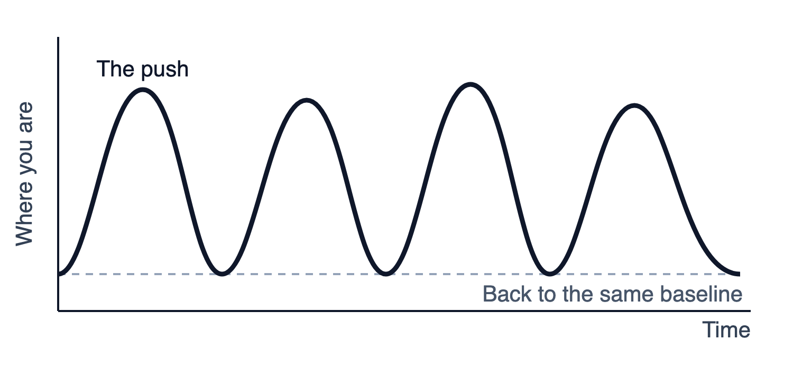
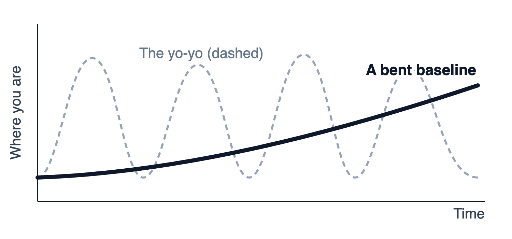
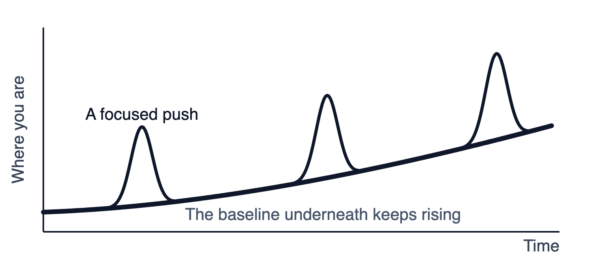

# Before You Start

This is a short book with a long job.

If you picked it up, there's a decent chance you've already read at least one of the good books on habits. Maybe James Clear's *Atomic Habits*, which explains how habits work better than I ever could. Maybe you underlined half of it. Maybe you started strong.

And maybe, a few months later, you looked up and found yourself right back where you started.

That's the gap this book is for. Not *how habits work*. You already know that. This book is about the part after the reading: the 21 days where you actually do something, and the months after that where you keep it.

Here's how it's built:

**Part One** is short. It explains why diets, budgets, and big fresh starts snap back, and what to do instead. Four chapters. You can read them in one sitting.

**Part Two** is the 21 days. One short chapter per day. Each one ends with a small thing to do today, usually in less time than it takes to read the chapter. Don't read ahead. Read one, do one.

**Part Three** is Day 22 and after: how to keep what you built, and what to do when life knocks you off track. A short bonus chapter at the end is for anyone who leads a team.

At the back you'll find simple trackers you can copy onto paper.

**A free companion app.** Every day in this book has a matching day in a free companion app: the same short exercise with a place to write your answer, a breathing timer that counts for you, and a tracker for your Peace of Mind Account. There's nothing to download from an app store. It runs in your phone's web browser, and you can put an icon for it on your home screen so it opens like any other app. Day 0 walks you through setting it up in about two minutes.

To get the link, scan the code below or go to **bendyourbaseline.com/book**.

::: {style="text-align:center"}
{width=26%}
:::

The book works fine without it. Some people like paper. Some people like having it on their phone.

One promise before we begin. Nothing in here requires you to become a different person by Friday. Every action is small on purpose. If one feels too big, shrink it. Small is the whole point.

Let's go.

# Part One: Why You Snap Back

# Chapter 1: Living on the Yo-Yo

If you've ever gone on a diet, started an exercise program, or tried to stick to a budget, you can probably tell this story without my help.

Something makes you start. Usually it's one of three things. **Desire**: you want to be in a better place. **Disgust**: you're tired of where you are. Or, if you're married, sometimes it's the third one. **Your spouse.** Desire, disgust, or spouse. One of them gets loud enough, and you decide: *this time, I'm really going to change.*

And often, at first, it works. That's the sneaky part. The first few weeks can feel great. The weight comes off. You're fitting into old clothes again. You feel fitter, faster, stronger. Or you finally feel like you're in control of your money instead of your money controlling you.

Then something happens.

Maybe it's a busy season at work. A sick kid. A vacation. A bad week that turns into a bad month. Nothing dramatic. You just stop.

And you don't notice it at first. That's the other sneaky part. There's no moment where you decide to give it all back. But three months later, six months later, you look up and realize the progress is gone. You're right back where you started.

A while later, the desire or the disgust (or the spouse) builds up again. You find a new program. Great results, early wins, and then, sure enough, something makes you stop. And back you go.

I call this **living on the yo-yo**.

{width=100%}

## Why the programs are built this way

Picture two programs side by side. One says *lose 20 pounds in two years*. The other says *lose 20 pounds in two weeks*. I know which one I'm tempted to sign up for.

We want quick results. The people who sell programs know it. That's why programs promising something big in a short window are so easy to find: six-pack abs in 30 days, your finances fixed in 60, a new you in 90.

Here's the problem. Big results in a short window usually take a very high level of intensity. The harder question is whether that level of intensity fits your ordinary life for very long. In my experience, and maybe in yours, it usually doesn't. Something makes you stop.

That's not a character flaw. A push has an end. When it ends, you tend to go back to where you were.

## The copy-and-paste resolution

There's one nice thing about the yo-yo. You never have to come up with new New Year's resolutions. You can just copy and paste last year's.

I wish I could say I've never done that.

I coached Division I college distance runners for four years, back in the early '90s. In those days, one of the worst things a runner could do was subscribe to a running magazine. Every month, a new issue arrived with a new workout that was *the key*. This one. No, this one. And the runners who chased every new key never stayed on any plan long enough to find out what it could do.

We do the same thing with diets, budgets, and gym memberships. When the program stops working, we don't ask why *we* stopped. We assume we picked the wrong program. So we pick another one.

## It isn't just you

Here's the part that surprised me most when I started paying attention. Organizations do this too.

If you've worked in a company for any length of time, you've seen it. Every quarter brings a new initiative, and every one is announced the same way: *"This isn't just for this quarter. This is our new direction."* A quarter or two later, a different initiative arrives, announced with the exact same sentence.

The people saying it aren't lying. They mean it every time. That's what makes it a design problem instead of a character problem. We'll come back to organizations in Part Three.

For now, the question is simple: if pushing harder isn't the answer, what is?

The answer starts with the thing you keep snapping back to.

# Chapter 2: Your Baseline

Here's the idea at the center of this book: every one of us has a baseline.

Your baseline is **your natural resting state in an area of your life**. It's where you end up when you're not trying. Where your weight settles. How much you move on an ordinary Tuesday. What's in your checking account the day before payday. How tense your shoulders are at 3 p.m.

Some of it is genetics. You didn't pick your height. Genetics is part of the picture. **The part this book focuses on is what you do every day, without thinking about it.** Your defaults. Your habits.

And when I'm tired or distracted, the easier option usually wins. I'm guessing you've seen that in your own life too. That's not a moral failure. It's just what ordinary days look like.

So when a program ends, you don't fall to zero. You fall back to your baseline. The program was a push on top of your ordinary life. When the push stops, your ordinary life is still there, doing exactly what it always did.

## Three baselines worth watching

In this book we'll work on three:

**Money.** How much cushion you have between you and the next surprise bill. Whether an unexpected expense is an *expense* or an *emergency*.

**Body.** How much you move, how you eat, how you sleep, on an ordinary day.

**Stress.** How much tension you carry around without noticing, and how fast you recover when something goes wrong.

These three don't live in separate boxes. They feed each other. Money stress keeps you up at night. Poor sleep makes every decision harder, including money decisions. Tension pushes you toward comfort food and comfort spending. The hope is that the loop can run the other direction too, so a small win in one area makes the next one a little easier.

## What the baseline looks like from here

I'm going to be 60 this year. So for me, the goal isn't always pushing my baseline up. Some years the goal is just to keep it from sliding down. I don't get any faster from year to year anymore. But I stay close to the same, and that's its own kind of win.

I have a personal reason for caring about this. When my dad passed away, he weighed over 380 pounds. I think about that more than I'd like to admit. I know how quickly I could get there if I stopped paying attention to the ordinary days.

That's the real lesson of the baseline. The ordinary days win. Not the heroic ones.

## Easy to do. Easy not to do.

If the answer is "small daily habits," why doesn't everybody just do that?

Two reasons.

First, small habits are slow. You do the right small thing for a month and can barely see a difference. We want the quick hit.

Second, and this is the one that gets me: **simple, easy things to do are also simple, easy things not to do.** It's such a small thing. Skipping it today won't matter. And that's true. Skipping it *today* won't matter. But skipping it today is how you get out of the habit by next week.

So the trick isn't finding a better program. The trick is working on the baseline itself: making a few small actions ordinary enough that they become your new default. The aim is that when life gets in the way (and it will), you have something small to fall back on instead of depending on the original push.

That's what it means to bend your baseline.

# Chapter 3: Bend, Don't Break

Jim Rohn put the whole idea in one line: "Success is a few simple disciplines, practiced every day."

That's it. That's the strategy. A few small changes in your daily habits, repeated until they stop feeling like effort.

Draw it on a napkin and it looks like this. The yo-yo is a line that shoots up and crashes down, over and over, always coming back to the same floor. A bent baseline is different: a line that rises slowly, almost boringly, so there's something workable to come back to when the push ends.

{width=100%}

## Automate or habituate

I use two ways to make a small action easier to repeat.

**Automate it**, so it happens without you. A transfer that moves money to savings on payday. A water bottle that's already on your desk. A watch that chimes every hour.

**Habituate it**, so it happens because it's what you do. I'm not sure "habituate" is a real word. I use it all the time anyway. It means you've done it enough times, in the same spot in your day, that not doing it would feel strange.

Everything in Part Two is aimed at one of those two. If it can't be automated or habituated, it probably won't last, so we don't spend much time on it.

## Margin

I have another name for what happens when you bend your baseline. I call it **building more margin**.

**Margin is the extra capacity to handle unexpected obstacles, or to take advantage of unexpected opportunities.**

A lot of us are running redlined. No extra capacity anywhere. Physically, financially, emotionally, we're right at the edge, so the smallest thing can throw off an entire day. Maybe that's just me. But I notice it most when I don't have enough margin.

You probably know the Itsy Bitsy Spider. Every time it rained, what happened to poor Itsy? Washed out. She had no margin.

Itsy has a lesser-known, smarter cousin. Her name is Bitsy. Bitsy built more margin. So when the rain comes (and the rain always comes), it doesn't wash her out.

Be like Bitsy.

{width=45%}

## Expense or emergency

Here's the clearest example of margin I know.

Your transmission goes out. Or you're asleep during a thunderstorm and you hear that dreaded *drip, drip, drip* from the ceiling.

If you can write a check and make the problem go away, you won't like writing that check. But it's an **expense**.

If the same thing happens and you don't have the money to fix it, it's an **emergency**.

Same transmission. Same roof. The only difference is the margin you had when it happened.

That difference is what we're going to build first. And if you build it long enough, without a major storm wiping it out, something interesting happens: your cushion starts to become an **opportunity fund**. Somebody once told me the opportunity of a lifetime comes along about once a quarter. Most of those opportunities cost something to take. Margin is what lets you say yes.

## The rules of bending

Everything in the 21 days follows a few rules:

1. **Small enough to survive a bad week.** If you can't do it on your worst day, it's too big. Shrink it.
2. **One at a time.** Don't try to fix everything on Monday.
3. **Specific, not vague.** "Eat better" is a wish. "No eating after dinner" is a habit.
4. **Automated or habituated.** If it depends on remembering and wanting to, it's fragile.
5. **Direction over speed.** You're not trying to get there fast. You're trying not to go back.

# Chapter 4: Baseline First

Here's a lesson from my years coaching college distance runners that belongs in this book.

Plenty of college athletes arrive with messy baselines, because the training is so intense that they never have to build good everyday habits. The intensity carries them. Then they graduate, the intensity goes away, and five or ten years later, you couldn't always pick the former scholarship athletes out of a lineup. Some of the ones I knew ended up in worse shape than people who never played a sport. They relied on the push, and the push ended.

That's the order this book follows. **Baseline first.**

There is a time for pushing hard. Runners do it every season, and so can you: a focused 60- or 90-day stretch toward one goal. Done well, a push like that has four ingredients: **specificity** (exactly where you're starting, where you're going, and by when), the right amount of **intensity** for that gap, **recovery** built into every week, and real **rest** between pushes. I call that turbocharging, and it's a subject for its own book.

{width=100%}

But a push without a bent baseline underneath it is just another trip on the yo-yo. So everything in the 21 days that follow is about the floor, not the peak. Get the floor right, and you'll have something to stand on when you're ready to push.
